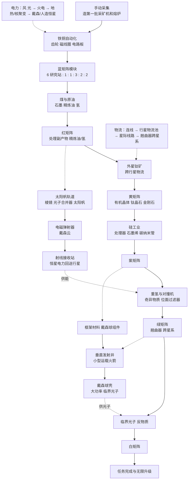

# 戴森球计划 · 无限画布版设计梳理

> 整理日期：2026-10-28。参考：[snowsnow0926/DSPONLINE](https://github.com/snowsnow0926/DSPONLINE)（1.2.x）与戴森球计划原版。
> 完整科技节点见 [dsp-tech-tree.md](dsp-tech-tree.md)；技术选型和架构决定见 [design-decisions.md](design-decisions.md)。

> 最新交互决定（2026-10-28）：矿脉和采矿机拆成独立节点，采矿机吸附到矿脉边缘开采；熔炉、制造台按设备类型建造，在节点中选择生产目标。下文早期「配方节点」的描述以此决定为准。

## 1. 参考项目 DSPONLINE 拆解

DSPONLINE（「DSP极简网络」）是一个 2D 无限画布的放置类工厂游戏：React 19 + React Flow + TypeScript + Vite，8 个星系、22 颗行星、78 种物品、78 个配方、37 种建筑、67 项科技。许可证是 PolyForm Noncommercial 1.0.0，**禁止商用，所以只借鉴思路，不用代码和素材**。

### 它是怎么做的

| 系统 | DSPONLINE 的做法 |
|---|---|
| 画布 | 每颗行星一张画布；节点是单台建筑，带输入/输出缓冲区 |
| 资源 | 矿脉、油井、海洋是资源节点，在上面放采矿机/萃取站/抽水站，储量会耗尽 |
| 传送带 | 连线连接输出端口和输入端口，吞吐量由带子等级和并行条数决定，可设优先级 |
| 物流站 | 五个物品槽，每槽设为供应/需求/仓储；行星内、星际靠运输船和翘曲器 |
| 电力 | 每颗行星有电网；风/光/地热无燃料，火电只补缺口；按优先级分电，节点显示缺电/缺料/空闲 |
| 科研 | 科技有前置，排队研究，消耗矩阵；可暂停、取消并保留已投入矩阵 |
| 戴森 | 弹射器发射太阳帆；每个星系独立的戴森云和球壳，电力不能跨星系；球壳要先有框架节点才能吸附太阳帆 |
| 离线 | 离开超过 60 秒，回来时可选快速结算（抽样）或精确结算（逐步模拟） |
| 建造中心 | 紫糖解锁，从行星库存取料，缺的中间件递归合成，可暂停续做 |
| 其他 | 云存档、账号、排行榜、Electron、Android、蓝图、模组、多核/Rust 原生模拟 |

### 可以借鉴的

- **一颗行星一张画布**，行星之间靠物流连接。
- **资源节点有储量**，采集建筑挂在资源节点上。
- **节点状态一眼可见**：缺电、缺料、出口堵塞、空闲用不同颜色或图标。
- **每个星系独立的戴森工程**，恒星亮度决定发电倍率。
- **确定性模拟 + 存档版本号**，离线结算和在线结果一致。
- **科研排队**，玩家不用一直盯着。

### 应该砍掉或简化的

| DSPONLINE | 我们的做法 | 原因 |
|---|---|---|
| 一个节点 = 一台建筑，逐个物品在缓冲区之间搬运 | 一个节点 = 一种配方 × N 台，按每分钟速率求解 | 节点数少一个数量级，离线结算是一次计算 |
| 传送带逐件模拟、分等级和条数 | 连线只表示「这种物品从 A 流向 B」，默认不限流（以后可加等级上限） | 无限画布上玩家关心的是配比，不是带子摆法 |
| 物流站五槽 + 运输船飞行 | 每颗行星一个「行星物流池」，星际线路只是「A 星每分钟送 X 到 B 星」 | 保留跨星规划，砍掉船只调度 |
| 建造中心递归合成 | 建筑直接从行星库存扣材料；缺什么就提示缺什么 | 递归合成是它的性能热点之一 |
| 战斗、黑雾 | 不做 | 和「搭产线」核心玩法无关 |
| 云存档、账号、排行榜、原生/多核 | 先不做 | 后期再说 |

### 它踩过的性能坑（我们提前规避）

它的性能报告里，一个 7.3MB 存档有 3978 个实体、8867 条连线，单颗行星最多 373 个实体、849 条线；拖动时 DOM 元素约 3000 个。有效的优化依次是：

1. **按行星分发数据**：别的行星变化不要触发当前画布重建。
2. **缓存拓扑**：拖动画布时不要重新跑一遍连线诊断。
3. **节点分级显示（LOD）**：缩小时节点只渲染简略版，选中的保持完整。
4. **连线改用 Canvas 批量画**，React Flow 只保留透明的点击区域。
5. **只渲染可见区域**。

报告的结论是：减少 DOM 节点收益最大，Canvas 画线本身只要 0.1–0.3ms，剩下的开销在模拟数据拷贝、递归规划和垃圾回收。我们用「配方 × N 台」的节点和速率求解，规模会小很多，第 1、3、5 条从一开始就做进去，第 4 条等真遇到瓶颈再做。

## 2. 资源与产物分层

按「离原矿有几步」分五层。画布上可以用层级给节点配色，让玩家一眼看出某条线处在哪个阶段。

### L0 原始资源

| 类别 | 资源 | 在哪里 |
|---|---|---|
| 常规矿 | 铁矿、铜矿、石矿、煤矿 | 起始星球 |
| 液体 | 水、原油、硫酸（硫酸海） | 起始星球（原油不一定有） |
| 外星矿 | 钛矿、硅矿 | 其他行星 |
| 稀有资源 | 可燃冰、金伯利矿、分形硅石、光栅石、刺笋结晶、单极磁石 | 特定行星，提供高效配方 |
| 气态巨星 | 氢、重氢、可燃冰 | 轨道采集器 |
| 恒星能量 | 太阳能、临界光子 | 射线接收站 |

### L1 冶炼与基础加工（一步）

铁块、铜块、石材、磁铁、玻璃、高能石墨、高纯硅块、钛块、精炼油、氢。

### L2 基础零件

齿轮、磁线圈、电路板、钢材、塑料、硫酸、金刚石、晶格硅、棱镜、电动机、重氢。

### L3 中级组件

微晶元件、处理器、石墨烯、碳纳米管、有机晶体、钛晶石、钛合金、钛化玻璃、电磁涡轮、超级磁场环、光子合并器、粒子容器。

### L4 高级组件

粒子宽带、奇异物质、引力透镜、卡西米尔晶体、位面过滤器、量子芯片、太阳帆、框架材料、戴森球组件、小型运载火箭、反物质、空间翘曲器。

### 最终产物（汇入科研或戴森）

- 六色矩阵：蓝、红、黄、紫、绿、白，用于科研。
- 太阳帆 → 戴森云；小型运载火箭 → 戴森球壳。
- 各类建筑本身（采矿机、熔炉、制造台……）也是产物，造建筑要消耗它们。

## 3. 科技树主干（7 个阶段）

完整 107 个节点见 [dsp-tech-tree.md](dsp-tech-tree.md)。下面只列推进主干，以及每个阶段在画布版里要开放什么。

| 阶段 | 研究消耗 | 主干科技 | 解锁的玩法 |
|---|---|---|---|
| 0 开局 | 实物（磁线圈、电路板、齿轮） | 电磁学 → 自动化冶金、基础制造、基础物流 | 采矿机、电弧熔炉、制造台、风力发电；第一条铁铜线 |
| 1 蓝 | 蓝 | 电磁矩阵、冶炼提纯、钢材冶炼、流体储存、火力发电、太阳能 | 研究站；石墨、硅、钢；火电和太阳能 |
| 2 红 | 蓝 + 红 | 等离子萃取精炼、基础化工、X 射线裂解、能量矩阵、半导体、处理器 | 原油线、氢、塑料、硫酸；**第一个副产物和回路问题** |
| 3 黄 | 蓝红 + 黄 | 钛矿冶炼、高分子化工、高强度晶体、结构矩阵、行星/星际物流 | **第一次需要外星资源**（钛）；跨行星物流 |
| 4 紫 | 蓝红黄 + 紫 | 应用型超导体、高强度材料、粒子可控、信息矩阵、微型核聚变 | 石墨烯、碳纳米管、粒子宽带；硅成为大宗原料 |
| 5 绿 | 前四色 + 绿 | 微型粒子对撞机、奇异物质、引力波折射、卡西米尔晶体、波函数干扰、量子芯片、引力矩阵 | 重氢、对撞机（耗电大户）；翘曲器，跨星系 |
| 6 白 / 戴森 | 五色 + 白 | 太阳帆轨道、射线接收站、垂直发射井、行星电离层利用、狄拉克逆变、宇宙矩阵 | 戴森云、戴森球壳、临界光子、反物质；任务完成 |

两条戴森支线**不要求白矩阵**：太阳帆轨道系统在红矩阵阶段就能研究，垂直发射井只要蓝红黄紫各 1600。所以戴森云可以在阶段 2–3 就开始铺，球壳在阶段 4–5 开始建。

画布版建议：科技不必全收。阶段 0–6 的主干加上生产设备、物流、电力三个分支就足够，战斗、黑雾、装饰全部去掉，大约 60–70 个节点，和 DSPONLINE 的 67 项接近。

## 4. 标准产线配比

**前提**：设备都按 1 倍速算（电弧熔炉、制造台 Mk.II、化工厂、精炼厂、矩阵研究站），不用增产剂、不算科研加速。制造台 Mk.I 是 0.75 倍速，用它时台数要乘 4/3。**这些数字是按原版配方推算的，没有在游戏里实测过**，做进游戏前应该用速率求解器再算一遍校对。

目标都取「每分钟 60 个矩阵」左右，便于对比。

### 4.1 单台设备每分钟产量

| 产物 | 配方（一轮） | 时间 | 单台 / 分钟 |
|---|---|---|---|
| 铁块、铜块、石材 | 矿×1 → 1 | 1 秒 | 60 |
| 磁铁 | 铁矿×1 → 1 | 1.5 秒 | 40 |
| 玻璃 | 石矿×2 → 1 | 2 秒 | 30 |
| 高能石墨 | 煤矿×2 → 1 | 2 秒 | 30 |
| 高纯硅块 | 硅矿×2 → 1 | 2 秒 | 30 |
| 钛块 | 钛矿×2 → 1 | 2 秒 | 30 |
| 钢材 | 铁块×3 → 1 | 3 秒 | 20 |
| 齿轮 | 铁块×1 → 1 | 1 秒 | 60 |
| 磁线圈 | 磁铁×2 + 铜块×1 → 2 | 1 秒 | 120 |
| 电路板 | 铁块×2 + 铜块×1 → 2 | 1 秒 | 120 |
| 等离子精炼 | 原油×2 → 精炼油×2 + 氢×1 | 4 秒 | 油 30、氢 15 |
| X 射线裂解 | 精炼油×1 + 氢×2 → 氢×3 + 石墨×1 | 4 秒 | 净 +15 氢、+15 石墨 |
| 塑料 | 精炼油×2 + 石墨×1 → 1 | 3 秒 | 20 |
| 金刚石 | 石墨×1 → 1 | 2 秒 | 30 |
| 有机晶体 | 塑料×2 + 精炼油×1 + 水×1 → 1 | 6 秒 | 10 |
| 钛晶石 | 有机晶体×1 + 钛块×3 → 1 | 4 秒 | 15 |

### 4.2 蓝矩阵（每分钟 120）

一个整齐的「标准模块」：

| 建筑 | 台数 | 产出 / 分钟 |
|---|---|---|
| 矩阵研究站（蓝） | 6 | 蓝 120 |
| 制造台：磁线圈 | 1 | 120 |
| 制造台：电路板 | 1 | 120 |
| 熔炉：磁铁 | 3 | 120 |
| 熔炉：铁块 | 2 | 120 |
| 熔炉：铜块 | 2 | 120 |

原矿：铁矿 240/分钟、铜矿 120/分钟。比例 **6 : 1 : 1 : 3 : 2 : 2**，非常适合做成新手教学里的第一个模块。

### 4.3 红矩阵（每分钟 60）

| 建筑 | 台数 | 说明 |
|---|---|---|
| 矩阵研究站（红） | 6 | 需要石墨 120、氢 120 |
| 熔炉：石墨 | 4 | 煤矿 240 |
| 精炼厂：等离子精炼 | 8 | 原油 240，产氢 120，**多出精炼油 240** |

多出来的精炼油必须有去处，否则精炼厂会堵。两个处理办法：

- **接 X 射线裂解**：1 台精炼厂配 2 台裂解，净产氢 45、石墨 30、不剩精炼油。约 2.7 台精炼厂 + 5.3 台裂解就能供 120 氢和 80 石墨，剩下 40 石墨由 1.3 台石墨熔炉补，原油只要 80。
- **留给黄矩阵的塑料线**。

裂解是「用氢产氢」的回路，速率求解器必须能处理环（见 design-decisions.md）。这也是第一个让玩家思考副产物的地方，值得在教学里专门讲。

### 4.4 黄矩阵（每分钟 60）

| 建筑 | 台数 | 输入 / 分钟 |
|---|---|---|
| 矩阵研究站（黄） | 8 | 金刚石 60、钛晶石 60 |
| 熔炉：金刚石 | 2 | 石墨 60 |
| 制造台：钛晶石 | 4 | 有机晶体 60、钛块 180 |
| 熔炉：钛块 | 6 | 钛矿 360 |
| 化工厂：有机晶体 | 6 | 塑料 120、精炼油 60、水 60 |
| 化工厂：塑料 | 6 | 精炼油 240、石墨 120 |
| 熔炉：石墨 | 6 | 煤矿 360（金刚石 60 + 塑料 120） |
| 精炼厂 | 10 | 原油 300 → 精炼油 300，副产氢 150 |

副产的 150 氢正好可以送去红矩阵线，这是红黄两线**互相配合**的好例子。钛矿 360/分钟来自外星，这一阶段开始需要跨行星物流。

### 4.5 紫矩阵（每分钟 60，只展开两层）

| 建筑 | 台数 | 输入 / 分钟 |
|---|---|---|
| 矩阵研究站（紫） | 10 | 处理器 120、粒子宽带 60 |
| 制造台：处理器（3 秒） | 6 | 电路板 240、微晶元件 240 |
| 制造台：粒子宽带（8 秒） | 8 | 碳纳米管 120、晶格硅 120、塑料 60 |
| 制造台：微晶元件（2 秒） | 8 | 高纯硅块 480、铜块 240 |
| 化工厂：碳纳米管（4 秒出 2） | 4 | 石墨烯 180、钛块 60 |
| 熔炉：晶格硅（2 秒） | 4 | 高纯硅块 120 |

硅矿需求约 1200/分钟（高纯硅 600），是这一阶段的大宗原料。

### 4.6 绿矩阵（每分钟 60，只展开两层）

| 建筑 | 台数 | 输入 / 分钟 |
|---|---|---|
| 矩阵研究站（绿，24 秒出 2） | 12 | 引力透镜 30、量子芯片 30 |
| 制造台：引力透镜（6 秒） | 3 | 金刚石 120、奇异物质 30 |
| 微型粒子对撞机：奇异物质（8 秒） | 4 | 粒子容器 60、铁块 60、重氢 300 |
| 制造台：量子芯片（6 秒） | 3 | 处理器 60、位面过滤器 60 |
| 制造台：位面过滤器（12 秒） | 12 | 卡西米尔晶体 60、钛化玻璃 120 |

瓶颈是**重氢 300/分钟**和对撞机的大功率，适合引出气态巨星开采和核聚变电站。

### 4.7 白矩阵（每分钟 60）

| 建筑 | 台数 | 输入 / 分钟 |
|---|---|---|
| 矩阵研究站（白，15 秒） | 15 | 五色矩阵各 60、反物质 60 |
| 微型粒子对撞机：反物质（2 秒） | 1 | 临界光子 60 → 反物质 60 + 氢 60 |

临界光子来自射线接收站（光子模式），产量取决于恒星亮度、接收站是否用引力透镜、以及该星系的戴森球功率，这部分要等设计戴森数值时一起定。白矩阵线本质上是**前五条线的汇总**，画布上应该表现成五条线汇入一个大节点。

### 4.8 戴森相关

| 产物 | 配方 | 单台 / 分钟 |
|---|---|---|
| 棱镜 | 玻璃×3 → 2，2 秒 | 60 |
| 光子合并器 | 棱镜×2 + 电路板×1 → 1，3 秒 | 20 |
| 太阳帆 | 石墨烯×1 + 光子合并器×1 → 2，4 秒 | 30 |
| 框架材料 | 碳纳米管×4 + 钛合金×1 + 高纯硅×1 → 1，6 秒 | 10 |
| 戴森球组件 | 框架×3 + 太阳帆×3 + 处理器×3 → 1，8 秒 | 7.5 |
| 小型运载火箭 | 戴森球组件×2 + 氘核燃料棒×4 + 量子芯片×2 → 1，6 秒 | 10 |

弹射器的发射速度、太阳帆寿命、每个球壳节点需要多少火箭，这些属于戴森系统的数值，原版数值较复杂，画布版建议简化成「每颗太阳帆 = X 功率，寿命 Y 分钟」「每枚火箭 = Z 结构点」三个参数，自己调平衡。

## 5. 整体建造流程

一条主线（矩阵与科研），两条支线（戴森云、戴森球壳），两条支撑线（电力、物流）。

每个阶段对玩家来说是同一个循环：

1. **看到新科技需要什么矩阵** → 2. **在画布上从目标节点往上游拉线**，系统提示缺哪些原料 → 3. **补资源节点和中间产线**，直到连线全绿 → 4. **研究**，解锁下一批配方和建筑 → 回到 1。

电力和物流是穿插在每个阶段里的「保障线」：新产线常常先因为缺电或某种原料不在本星球而变黄变红，引导玩家去扩电网或开物流线路。

## 6. 无限画布版的设计建议

### 6.1 节点类型

| 节点 | 含义 | 关键数据 |
|---|---|---|
| 资源节点 | 一处矿脉 / 油井 / 海洋 / 气态巨星轨道 | 资源种类、储量、采集建筑 × N |
| 配方节点 | 一种配方 × N 台同种建筑 | 配方、台数、满足率 |
| 仓库节点 | 缓冲和展示库存 | 各物品库存、上限 |
| 研究节点 | 研究站 × N，消耗矩阵 | 当前研究、速率 |
| 发电节点 | 发电建筑 × N | 功率、燃料 |
| 物流节点 | 行星物流池的出入口 | 供应 / 需求的物品和速率 |
| 戴森节点 | 弹射器 / 发射井 / 接收站 | 发射速率、接收功率 |
| 模块节点 | 一组节点折叠成一个，只露出对外端口 | 内部子图 |

### 6.2 让操作方便的几个关键交互

- **从端口拖出新节点**：从一个输入端口拖到空白处，弹出能产出该物品的配方列表，选中后自动建好连线。这是最省事的建线方式。
- **一键补齐台数**：节点显示「需要 7.5 台，现在 6 台」，点一下自动调到满足下游需求的整数台数。
- **连线颜色**：绿 = 供需匹配；黄 = 供不应求（下游满足率 < 100%）；红 = 完全断供或出口堵塞。连线上显示每分钟速率。
- **副产物提示**：配方有多个产出时，没接走的产出端口高亮，提示会堵。
- **模块与蓝图**：框选一组节点 → 折叠成模块 → 保存成蓝图，在别处一键放置。蓝矩阵 6:1:1:3:2:2 就是第一个预置蓝图。
- **按行星切换画布**，顶部常驻全局资源条和电力条；星系图单独一个视图，用来开星际线路。

### 6.3 数值模型（已选 B，保留方案对比）

| 方案 | 做法 | 优点 | 缺点 |
|---|---|---|---|
| A. 纯速率 | 每轮解出每条线的稳定速率和满足率；仓库只按净速率累加 | 实现简单；离线结算是「速率 × 时间」；节点再多也不卡 | 少了物品逐个流动的手感；启动过程（从空到满）表现不出来 |
| B. 库存模拟 | 每个节点有缓冲区，每个时间步搬运物品 | 有手感，能看到堵塞传播 | 实现复杂，离线结算要逐步模拟或抽样（DSPONLINE 就是这样，也为此做了大量性能优化） |
| C. 混合 | 产线按速率求解，只在仓库和物流池保留库存 | 兼顾两者，复杂度可控 | 要定义好「速率」和「库存」的边界 |

**最终决定：方案 B「库存模拟」**。节点仍按「配方 × N 台」聚合，每秒 10 个固定步长，以整数库存推进生产与运输。方案 C 是讨论时的早期建议，未采用。离线结算暂不做，具体约束见 [design-decisions.md](design-decisions.md)。

## 7. 分期计划

| 阶段 | 内容 | 完成标准 |
|---|---|---|
| P0 原型 | React + React Flow + 轻量 ECS；资源、配方、仓库三种节点；连线；固定步长的缓冲区搬运模拟（含环）；连线绿黄红 | 能在画布上手动搭出蓝矩阵 6:1:1:3:2:2 并显示全绿 |
| P1 科研与电力 | 研究节点、科技树（阶段 0–2）、电网和缺电降速、从端口拖出新节点、一键补齐台数 | 从开局玩到红矩阵 |
| P2 多行星 | 行星切换、行星物流池、星际线路、外星资源 | 跨行星运钛，做出黄矩阵 |
| P3 中后期产线 | 阶段 3–5 的配方与科技、模块折叠、蓝图 | 做出紫、绿矩阵 |
| P4 戴森 | 太阳帆、弹射器、戴森云、射线接收站、发射井、球壳、临界光子、反物质 | 做出白矩阵，完成任务 |
| P5 打磨 | 存档迁移、新手引导、性能（LOD、可见区域渲染、必要时 Canvas 画线）、平衡；离线结算暂不做 | 可以给别人玩 |

## 8. 待决问题

1. ~~**数值模型**~~：已定方案 B（库存模拟），实现要点见 design-decisions.md。
2. **科技范围**：是否按建议只保留主干 + 生产 + 物流 + 电力约 60–70 项？
3. **戴森数值**：是否按建议简化成太阳帆功率、寿命、火箭结构点三个参数？
4. **稀有资源**：可燃冰、分形硅石等高效配方是否做进来？做的话会增加行星差异性，但也增加配方数量。
