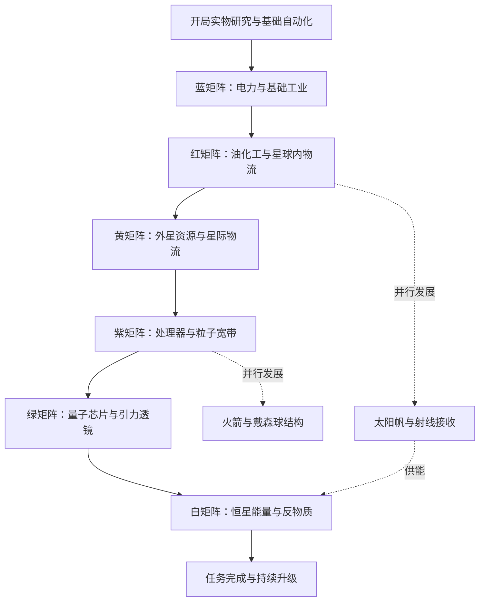
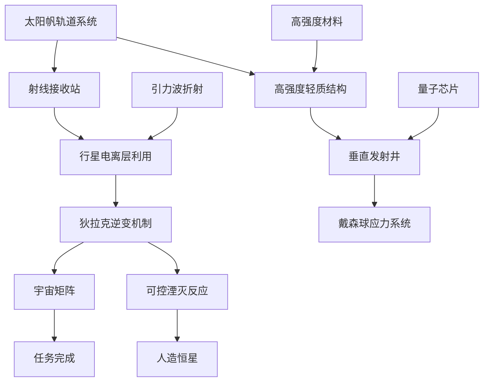

# 戴森球计划原版科技树

这份科技树整理《戴森球计划》原版的科研主线、生产、材料、物流、电力、战斗、黑雾隐藏科技和装饰分支。核心推进节奏是：建立自动化生产 → 蓝红矩阵 → 外星资源与黄矩阵 → 紫绿矩阵 → 反物质与白矩阵，物流、电力和戴森工程在其中交叉发展。

整理日期：2026 年 10 月 28 日。科技节点依据 BWIKI 科技表及各节点页面，收录 107 个非重复等级科技节点；升级按系列汇总，不逐级展开所有等级数值。

# 如何阅读科技树

表格中的“直接前置”表示研究该科技前需要完成的上游科技；多个前置通常需要全部满足。研究消耗是点亮科技的成本，配方原料是生产物品的成本，两者分开列出。即使科技已经解锁，制造建筑或稳定生产矩阵仍可能依赖其他材料链。

蓝、红、黄、紫、绿、白分别简称六种常规矩阵。表内“黄需解锁”“紫需解锁”保留来源中仅标注“解锁”的条件，不补写成矩阵消耗数量。黑雾矩阵单独列出。

下方阶段图表示推荐推进顺序，不表示每一条箭头都是游戏中的直接前置。完整的科技依赖以节点表为准。

# 六种矩阵与生产门槛

以下为原版基础配方，每行按一轮生产列出；不计增产剂、设备速度和研究升级。绿色矩阵每轮产出 2 个，不能把一轮原料误算成每个矩阵的原料。

| 阶段 | 矩阵 | 基础配方 | 一轮时间与产出 | 产业重点 |
| --- | --- | --- | --- | --- |
| 蓝 | [电磁矩阵](https://wiki.biligame.com/dsp/%E7%94%B5%E7%A3%81%E7%9F%A9%E9%98%B5) | 磁线圈×1＋电路板×1 | 3 秒，1 个 | 铁铜冶炼与基础装配 |
| 红 | [能量矩阵](https://wiki.biligame.com/dsp/%E8%83%BD%E9%87%8F%E7%9F%A9%E9%98%B5) | 高能石墨×2＋氢×2 | 6 秒，1 个 | 煤加工、原油精炼和副产物处理 |
| 黄 | [结构矩阵](https://wiki.biligame.com/dsp/%E7%BB%93%E6%9E%84%E7%9F%A9%E9%98%B5) | 金刚石×1＋钛晶石×1 | 8 秒，1 个 | 钛资源、有机晶体与晶体加工 |
| 紫 | [信息矩阵](https://wiki.biligame.com/dsp/%E4%BF%A1%E6%81%AF%E7%9F%A9%E9%98%B5) | 处理器×2＋粒子宽带×1 | 10 秒，1 个 | 硅工业、碳纳米管与高分子材料 |
| 绿 | [引力矩阵](https://wiki.biligame.com/dsp/%E5%BC%95%E5%8A%9B%E7%9F%A9%E9%98%B5) | 引力透镜×1＋量子芯片×1 | 24 秒，2 个 | 奇异物质、卡西米尔晶体与位面过滤器 |
| 白 | [宇宙矩阵](https://wiki.biligame.com/dsp/%E5%AE%87%E5%AE%99%E7%9F%A9%E9%98%B5) | 蓝红黄紫绿矩阵各×1＋反物质×1 | 15 秒，1 个 | 五色矩阵汇流、临界光子与反物质 |

# 原版推荐推进路线

以下优先级面向常规工业推进；战斗存档还需根据黑雾威胁提前投入防御。

1. **先完成基础自动化。** 从电磁学出发，补齐自动化冶金、基础物流、基础制造和电磁矩阵，让铁、铜、磁线圈、电路板形成持续产出。
2. **建立红矩阵产线。** 发展流体储存封装、高效电浆控制、等离子萃取精炼与能量矩阵，同时解决高能石墨供应。储液罐能缓冲精炼油和氢，但长期仍要为两种产物安排去向。
3. **拿到钛资源并启动黄矩阵。** 提升机甲航行能力，准备外星采矿；有机晶体、钛晶石和金刚石构成黄矩阵的主要物料链。行星物流用于同星球运输，星际物流用于跨行星运输。
4. **用物流支撑紫矩阵。** 优先稳定钛、硅以及处理器、碳纳米管、粒子宽带的供应，再扩大科研规模。
5. **推进绿矩阵和跨恒星发展。** 同时展开量子芯片链与奇异物质、引力透镜链。翘曲器的配方、机甲曲速能力和运输船曲速能力分别检查，不能用“拿到绿矩阵”概括全部航行条件。
6. **用恒星能量生产白矩阵。** 推进射线接收、行星电离层利用和狄拉克逆变机制，形成临界光子到反物质的供给；完成宇宙矩阵研究后，用白矩阵推进任务完成和后续升级。

原版的机甲星际航行在驱动引擎 2 解锁。常规开局可以先人工往返外星运回钛，再建立黄矩阵产线与星际物流；星际物流本身需要蓝×1200、红×1200、黄×120。[机甲升级](https://wiki.biligame.com/dsp/%E5%8D%87%E7%BA%A7#驱动引擎2)、[星际物流系统](https://wiki.biligame.com/dsp/%E6%98%9F%E9%99%85%E7%89%A9%E6%B5%81%E7%B3%BB%E7%BB%9F)。

## 白矩阵与戴森球工程

这两条路线交叉发展。下图只展开后期关键研究前置；每个节点的其他直接前置和研究消耗见后面的完整表格。

原版垂直发射井研究消耗蓝红黄紫各 1600，不需要白矩阵；因此造球可以早于白矩阵。宇宙矩阵的直接科技前置是狄拉克逆变机制，人造恒星和完整戴森球均不是其直接前置。太阳帆形成的戴森云也能为射线接收提供恒星能量。[垂直发射井](https://wiki.biligame.com/dsp/%E5%9E%82%E7%9B%B4%E5%8F%91%E5%B0%84%E4%BA%95%EF%BC%88%E7%A7%91%E6%8A%80%EF%BC%89)、[宇宙矩阵科技](https://wiki.biligame.com/dsp/%E5%AE%87%E5%AE%99%E7%9F%A9%E9%98%B5%EF%BC%88%E7%A7%91%E6%8A%80%EF%BC%89)、[太阳帆轨道系统](https://wiki.biligame.com/dsp/%E5%A4%AA%E9%98%B3%E5%B8%86%E8%BD%A8%E9%81%93%E7%B3%BB%E7%BB%9F)。

# 原版科技节点表

节点按功能分支归类，表内保留直接科技前置、基础研究消耗和解锁内容。科技名称可点击进入对应资料页。分支名称不代表严格研究先后；表中的“戴森球计划”是起始节点名称。

## 矩阵与恒星能源主线

13 项。

| 科技 | 直接前置 | 研究消耗 | 解锁内容 |
| --- | --- | --- | --- |
| [电磁矩阵](https://wiki.biligame.com/dsp/%E7%94%B5%E7%A3%81%E7%9F%A9%E9%98%B5%EF%BC%88%E7%A7%91%E6%8A%80%EF%BC%89) | 电磁学 | 磁线圈×10、电路板×10 | 电磁矩阵、矩阵研究站 |
| [太阳能收集](https://wiki.biligame.com/dsp/%E5%A4%AA%E9%98%B3%E8%83%BD%E6%94%B6%E9%9B%86) | 冶炼提纯、电磁矩阵、基础制造 | 蓝×200 | 太阳能板 |
| [能量矩阵](https://wiki.biligame.com/dsp/%E8%83%BD%E9%87%8F%E7%9F%A9%E9%98%B5%EF%BC%88%E7%A7%91%E6%8A%80%EF%BC%89) | 等离子萃取精炼 | 蓝×200 | 能量矩阵 |
| [光子变频](https://wiki.biligame.com/dsp/%E5%85%89%E5%AD%90%E5%8F%98%E9%A2%91) | 太阳能收集 | 蓝×200、红×200 | 光子合并器、光子合并器(高效) |
| [太阳帆轨道系统](https://wiki.biligame.com/dsp/%E5%A4%AA%E9%98%B3%E5%B8%86%E8%BD%A8%E9%81%93%E7%B3%BB%E7%BB%9F) | 光子变频、超级磁场发生器 | 蓝×300、红×300 | 太阳帆、电磁轨道弹射器 |
| [射线接收站](https://wiki.biligame.com/dsp/%E5%B0%84%E7%BA%BF%E6%8E%A5%E6%94%B6%E7%AB%99%EF%BC%88%E7%A7%91%E6%8A%80%EF%BC%89) | 太阳帆轨道系统 | 蓝×600、红×600 | 射线接收站 |
| [结构矩阵](https://wiki.biligame.com/dsp/%E7%BB%93%E6%9E%84%E7%9F%A9%E9%98%B5%EF%BC%88%E7%A7%91%E6%8A%80%EF%BC%89) | 高强度晶体 | 蓝×800、红×800 | 结构矩阵 |
| [信息矩阵](https://wiki.biligame.com/dsp/%E4%BF%A1%E6%81%AF%E7%9F%A9%E9%98%B5%EF%BC%88%E7%A7%91%E6%8A%80%EF%BC%89) | 处理器、粒子可控 | 蓝×800、红×800、黄需解锁 | 信息矩阵 |
| [引力矩阵](https://wiki.biligame.com/dsp/%E5%BC%95%E5%8A%9B%E7%9F%A9%E9%98%B5%EF%BC%88%E7%A7%91%E6%8A%80%EF%BC%89) | 量子芯片、引力波折射 | 蓝×1600、红×1600、黄×1600、紫需解锁 | 引力矩阵、空间翘曲器(高级) |
| [行星电离层利用](https://wiki.biligame.com/dsp/%E8%A1%8C%E6%98%9F%E7%94%B5%E7%A6%BB%E5%B1%82%E5%88%A9%E7%94%A8) | 射线接收站、引力波折射 | 蓝×2000、红×2000、黄×2000、绿×2000 | 射线接收站使用引力透镜 |
| [狄拉克逆变机制](https://wiki.biligame.com/dsp/%E7%8B%84%E6%8B%89%E5%85%8B%E9%80%86%E5%8F%98%E6%9C%BA%E5%88%B6) | 行星电离层利用 | 蓝×3000、红×3000、黄×750、紫×750、绿×1500 | 质能储存 |
| [宇宙矩阵](https://wiki.biligame.com/dsp/%E5%AE%87%E5%AE%99%E7%9F%A9%E9%98%B5%EF%BC%88%E7%A7%91%E6%8A%80%EF%BC%89) | 狄拉克逆变机制 | 蓝×2000、红×2000、黄×2000、紫×2000、绿×2000 | 宇宙矩阵生产 |
| [任务完成!](https://wiki.biligame.com/dsp/%E4%BB%BB%E5%8A%A1%E5%AE%8C%E6%88%90%21) | 宇宙矩阵 | 白×4000 | 主线目标达成 |

## 生产设备

12 项。

| 科技 | 直接前置 | 研究消耗 | 解锁内容 |
| --- | --- | --- | --- |
| [自动化冶金](https://wiki.biligame.com/dsp/%E8%87%AA%E5%8A%A8%E5%8C%96%E5%86%B6%E9%87%91) | 电磁学 | 磁线圈×10、电路板×10 | 电弧熔炉、玻璃 |
| [基础制造](https://wiki.biligame.com/dsp/%E5%9F%BA%E7%A1%80%E5%88%B6%E9%80%A0) | 电磁学 | 电路板×10、齿轮×10 | 制造台Mk.I |
| [等离子萃取精炼](https://wiki.biligame.com/dsp/%E7%AD%89%E7%A6%BB%E5%AD%90%E8%90%83%E5%8F%96%E7%B2%BE%E7%82%BC) | 流体储存封装、高效电浆控制 | 蓝×100 | 原油萃取站、原油精炼厂、等离子精炼 |
| [基础化工](https://wiki.biligame.com/dsp/%E5%9F%BA%E7%A1%80%E5%8C%96%E5%B7%A5) | 流体储存封装、等离子萃取精炼 | 蓝×200 | 化工厂、塑料、硫酸 |
| [重氢分馏](https://wiki.biligame.com/dsp/%E9%87%8D%E6%B0%A2%E5%88%86%E9%A6%8F) | 火力发电、等离子萃取精炼 | 蓝×200、红×300 | 分馏塔、重氢分馏 |
| [高速制造](https://wiki.biligame.com/dsp/%E9%AB%98%E9%80%9F%E5%88%B6%E9%80%A0) | 基础制造、处理器 | 蓝×600、红×300 | 制造台Mk.II |
| [微型粒子对撞机](https://wiki.biligame.com/dsp/%E5%BE%AE%E5%9E%8B%E7%B2%92%E5%AD%90%E5%AF%B9%E6%92%9E%E6%9C%BA%EF%BC%88%E7%A7%91%E6%8A%80%EF%BC%89) | 结构矩阵 | 蓝×800、红×800、黄×800 | 微型粒子对撞机、重氢 |
| [位面冶金](https://wiki.biligame.com/dsp/%E4%BD%8D%E9%9D%A2%E5%86%B6%E9%87%91) | 波函数干扰、晶体冶炼 | 蓝×1000、红×1000、黄×1000、紫×1000 | 位面熔炉 |
| [量子打印](https://wiki.biligame.com/dsp/%E9%87%8F%E5%AD%90%E6%89%93%E5%8D%B0) | 高速制造、量子芯片 | 蓝×800、红×800、黄×800、紫×800 | 制造台Mk.III |
| [亚微观量子纠缠](https://wiki.biligame.com/dsp/%E4%BA%9A%E5%BE%AE%E8%A7%82%E9%87%8F%E5%AD%90%E7%BA%A0%E7%BC%A0) | 量子芯片、奇异物质 | 蓝×1000、红×1000、黄×1000、紫×1000 | 量子化工厂 |
| [垂直发射井](https://wiki.biligame.com/dsp/%E5%9E%82%E7%9B%B4%E5%8F%91%E5%B0%84%E4%BA%95%EF%BC%88%E7%A7%91%E6%8A%80%EF%BC%89) | 高强度轻质结构、量子芯片 | 蓝×1600、红×1600、黄×1600、紫×1600 | 垂直发射井、小型运载火箭 |
| [光子聚束采矿](https://wiki.biligame.com/dsp/%E5%85%89%E5%AD%90%E8%81%9A%E6%9D%9F%E9%87%87%E7%9F%BF) | 量子芯片 | 蓝×1000、红×1000、黄×1000、紫×1000、绿×600 | 大型采矿机 |

## 材料与配方

31 项。

| 科技 | 直接前置 | 研究消耗 | 解锁内容 |
| --- | --- | --- | --- |
| [电磁驱动](https://wiki.biligame.com/dsp/%E7%94%B5%E7%A3%81%E9%A9%B1%E5%8A%A8) | 电磁学 | 蓝×50 | 电动机 |
| [动力引擎](https://wiki.biligame.com/dsp/%E5%8A%A8%E5%8A%9B%E5%BC%95%E6%93%8E%EF%BC%88%E7%A7%91%E6%8A%80%EF%BC%89) | 电磁学 | 蓝×20 | 动力引擎 |
| [钢材冶炼](https://wiki.biligame.com/dsp/%E9%92%A2%E6%9D%90%E5%86%B6%E7%82%BC) | 自动化冶金 | 蓝×120 | 钢材 |
| [冶炼提纯](https://wiki.biligame.com/dsp/%E5%86%B6%E7%82%BC%E6%8F%90%E7%BA%AF) | 自动化冶金 | 蓝×100 | 硅石、高能石墨、高纯硅块 |
| [移山填海工程](https://wiki.biligame.com/dsp/%E7%A7%BB%E5%B1%B1%E5%A1%AB%E6%B5%B7%E5%B7%A5%E7%A8%8B) | 钢材冶炼 | 蓝×400 | 地基 |
| [半导体材料](https://wiki.biligame.com/dsp/%E5%8D%8A%E5%AF%BC%E4%BD%93%E6%9D%90%E6%96%99) | 基础制造 | 蓝×200 | 微晶元件 |
| [处理器](https://wiki.biligame.com/dsp/%E5%A4%84%E7%90%86%E5%99%A8%EF%BC%88%E7%A7%91%E6%8A%80%EF%BC%89) | 半导体材料 | 蓝×800 | 处理器 |
| [应用型超导体](https://wiki.biligame.com/dsp/%E5%BA%94%E7%94%A8%E5%9E%8B%E8%B6%85%E5%AF%BC%E4%BD%93) | 基础化工 | 蓝×400 | 石墨烯、石墨烯(高效) |
| [晶体冶炼](https://wiki.biligame.com/dsp/%E6%99%B6%E4%BD%93%E5%86%B6%E7%82%BC) | 冶炼提纯 | 蓝×500、红×500 | 金刚石、金刚石(高效)、晶格硅 |
| [磁悬浮](https://wiki.biligame.com/dsp/%E7%A3%81%E6%82%AC%E6%B5%AE) | 电磁驱动 | 蓝×400、红×100 | 电磁涡轮 |
| [钛矿冶炼](https://wiki.biligame.com/dsp/%E9%92%9B%E7%9F%BF%E5%86%B6%E7%82%BC) | 钢材冶炼 | 蓝×200、红×200 | 钛块 |
| [高分子化工](https://wiki.biligame.com/dsp/%E9%AB%98%E5%88%86%E5%AD%90%E5%8C%96%E5%B7%A5) | 基础化工 | 蓝×400、红×400 | 有机晶体、有机晶体(原始) |
| [X射线裂解](https://wiki.biligame.com/dsp/X%E5%B0%84%E7%BA%BF%E8%A3%82%E8%A7%A3) | 基础化工、等离子萃取精炼 | 蓝×400、红×400 | X射线裂解 |
| [重整精炼](https://wiki.biligame.com/dsp/%E9%87%8D%E6%95%B4%E7%B2%BE%E7%82%BC) | X射线裂解 | 蓝×500、红×500 | 重整精炼 |
| [推进器](https://wiki.biligame.com/dsp/%E6%8E%A8%E8%BF%9B%E5%99%A8%EF%BC%88%E7%A7%91%E6%8A%80%EF%BC%89) | 氢燃料棒 | 红×1000 | 推进器 |
| [超级磁场发生器](https://wiki.biligame.com/dsp/%E8%B6%85%E7%BA%A7%E7%A3%81%E5%9C%BA%E5%8F%91%E7%94%9F%E5%99%A8) | 磁悬浮 | 蓝×1000、红×250 | 超级磁场环 |
| [高强度晶体](https://wiki.biligame.com/dsp/%E9%AB%98%E5%BC%BA%E5%BA%A6%E6%99%B6%E4%BD%93) | 高分子化工 | 蓝×600、红×600 | 钛晶石 |
| [增产剂Mk.II](https://wiki.biligame.com/dsp/%E5%A2%9E%E4%BA%A7%E5%89%82Mk.II%EF%BC%88%E7%A7%91%E6%8A%80%EF%BC%89) | 增产剂Mk.I、处理器 | 蓝×800、红×600 | 增产剂Mk.II |
| [粒子磁力阱](https://wiki.biligame.com/dsp/%E7%B2%92%E5%AD%90%E7%A3%81%E5%8A%9B%E9%98%B1) | 磁悬浮 | 蓝×1600、红×800 | 粒子容器、粒子容器(高效) |
| [加力推进器](https://wiki.biligame.com/dsp/%E5%8A%A0%E5%8A%9B%E6%8E%A8%E8%BF%9B%E5%99%A8%EF%BC%88%E7%A7%91%E6%8A%80%EF%BC%89) | 推进器 | 红×1600 | 加力推进器 |
| [高强度钛合金](https://wiki.biligame.com/dsp/%E9%AB%98%E5%BC%BA%E5%BA%A6%E9%92%9B%E5%90%88%E9%87%91) | 钛矿冶炼 | 蓝×800、红×800、黄×80 | 钛合金 |
| [高强度轻质结构](https://wiki.biligame.com/dsp/%E9%AB%98%E5%BC%BA%E5%BA%A6%E8%BD%BB%E8%B4%A8%E7%BB%93%E6%9E%84) | 太阳帆轨道系统、高强度材料 | 蓝×1200、黄×200 | 框架材料、戴森球组件 |
| [高强度材料](https://wiki.biligame.com/dsp/%E9%AB%98%E5%BC%BA%E5%BA%A6%E6%9D%90%E6%96%99) | 应用型超导体 | 红×600、黄×150 | 碳纳米管、碳纳米管(高效) |
| [粒子可控](https://wiki.biligame.com/dsp/%E7%B2%92%E5%AD%90%E5%8F%AF%E6%8E%A7) | 高强度材料 | 蓝×800、红×800、黄×200 | 粒子宽带、晶格硅(高效) |
| [高强度玻璃](https://wiki.biligame.com/dsp/%E9%AB%98%E5%BC%BA%E5%BA%A6%E7%8E%BB%E7%92%83) | 高强度材料 | 红×800、黄×400 | 钛化玻璃 |
| [卡西米尔晶体](https://wiki.biligame.com/dsp/%E5%8D%A1%E8%A5%BF%E7%B1%B3%E5%B0%94%E6%99%B6%E4%BD%93%EF%BC%88%E7%A7%91%E6%8A%80%EF%BC%89) | 结构矩阵 | 蓝×800、红×800、黄×800 | 卡西米尔晶体、卡西米尔晶体(高效) |
| [增产剂Mk.III](https://wiki.biligame.com/dsp/%E5%A2%9E%E4%BA%A7%E5%89%82Mk.III%EF%BC%88%E7%A7%91%E6%8A%80%EF%BC%89) | 增产剂Mk.II、高强度材料 | 蓝×800、红×600、黄×400 | 增产剂Mk.III |
| [奇异物质](https://wiki.biligame.com/dsp/%E5%A5%87%E5%BC%82%E7%89%A9%E8%B4%A8%EF%BC%88%E7%A7%91%E6%8A%80%EF%BC%89) | 微型粒子对撞机 | 蓝×1000、红×1000、黄×1000 | 奇异物质 |
| [引力波折射](https://wiki.biligame.com/dsp/%E5%BC%95%E5%8A%9B%E6%B3%A2%E6%8A%98%E5%B0%84) | 奇异物质、粒子磁力阱 | 蓝×1200、红×1200、黄×1200 | 引力透镜、空间翘曲器 |
| [波函数干扰](https://wiki.biligame.com/dsp/%E6%B3%A2%E5%87%BD%E6%95%B0%E5%B9%B2%E6%89%B0) | 高强度玻璃、卡西米尔晶体 | 蓝×1200、红×1200、紫×200 | 位面过滤器 |
| [量子芯片](https://wiki.biligame.com/dsp/%E9%87%8F%E5%AD%90%E8%8A%AF%E7%89%87%EF%BC%88%E7%A7%91%E6%8A%80%EF%BC%89) | 信息矩阵、波函数干扰 | 蓝×800、红×800、紫×800 | 量子芯片 |

## 物流运输

10 项。

| 科技 | 直接前置 | 研究消耗 | 解锁内容 |
| --- | --- | --- | --- |
| [基础物流系统](https://wiki.biligame.com/dsp/%E5%9F%BA%E7%A1%80%E7%89%A9%E6%B5%81%E7%B3%BB%E7%BB%9F) | 电磁学 | 齿轮×10、电路板×10 | 传送带、分拣器、小型储物仓 |
| [流体储存封装](https://wiki.biligame.com/dsp/%E6%B5%81%E4%BD%93%E5%82%A8%E5%AD%98%E5%B0%81%E8%A3%85) | 电磁学 | 蓝×50 | 储液罐、抽水站 |
| [改良物流系统](https://wiki.biligame.com/dsp/%E6%94%B9%E8%89%AF%E7%89%A9%E6%B5%81%E7%B3%BB%E7%BB%9F) | 基础物流系统 | 蓝×100 | 四向分流器、高速分拣器、流速监测器 |
| [增产剂Mk.I](https://wiki.biligame.com/dsp/%E5%A2%9E%E4%BA%A7%E5%89%82Mk.I%EF%BC%88%E7%A7%91%E6%8A%80%EF%BC%89) | 高效电浆控制、半导体材料 | 蓝×200 | 增产剂Mk.I、喷涂机 |
| [高效物流系统](https://wiki.biligame.com/dsp/%E9%AB%98%E6%95%88%E7%89%A9%E6%B5%81%E7%B3%BB%E7%BB%9F) | 改良物流系统、磁悬浮 | 蓝×400、红×100 | 高速传送带、极速分拣器、大型储物仓 |
| [配送物流系统](https://wiki.biligame.com/dsp/%E9%85%8D%E9%80%81%E7%89%A9%E6%B5%81%E7%B3%BB%E7%BB%9F) | 改良物流系统、磁悬浮 | 蓝×600、红×300 | 物流配送器、配送运输机 |
| [行星物流系统](https://wiki.biligame.com/dsp/%E8%A1%8C%E6%98%9F%E7%89%A9%E6%B5%81%E7%B3%BB%E7%BB%9F) | 高效物流系统、推进器、垂直建造1 | 蓝×800、红×400 | 极速传送带、行星内物流运输站、物流运输机 |
| [集装物流系统](https://wiki.biligame.com/dsp/%E9%9B%86%E8%A3%85%E7%89%A9%E6%B5%81%E7%B3%BB%E7%BB%9F) | 高效物流系统、超级磁场发生器 | 蓝×1000、红×500、黄×50 | 自动集装机、集装分拣器 |
| [星际物流系统](https://wiki.biligame.com/dsp/%E6%98%9F%E9%99%85%E7%89%A9%E6%B5%81%E7%B3%BB%E7%BB%9F) | 行星物流系统、高强度钛合金、加力推进器 | 蓝×1200、红×1200、黄×120 | 星际物流运输站、星际物流运输船 |
| [气态行星开采](https://wiki.biligame.com/dsp/%E6%B0%94%E6%80%81%E8%A1%8C%E6%98%9F%E5%BC%80%E9%87%87) | 星际物流系统、星际电力运输 | 蓝×1200、红×1200、黄×1200 | 轨道采集器 |

## 发电与供电

11 项。

| 科技 | 直接前置 | 研究消耗 | 解锁内容 |
| --- | --- | --- | --- |
| [电磁学](https://wiki.biligame.com/dsp/%E7%94%B5%E7%A3%81%E5%AD%A6) | 戴森球计划 | 磁线圈×10 | 风力涡轮机、电力感应塔、采矿机 |
| [高效电浆控制](https://wiki.biligame.com/dsp/%E9%AB%98%E6%95%88%E7%94%B5%E6%B5%86%E6%8E%A7%E5%88%B6) | 电磁学 | 蓝×50 | 棱镜、电浆激发器、无线输电塔 |
| [火力发电](https://wiki.biligame.com/dsp/%E7%81%AB%E5%8A%9B%E5%8F%91%E7%94%B5) | 基础制造 | 蓝×30 | 火力发电厂 |
| [氢燃料棒](https://wiki.biligame.com/dsp/%E6%B0%A2%E7%87%83%E6%96%99%E6%A3%92) | 能量矩阵 | 红×400 | 液氢燃料棒 |
| [能量储存](https://wiki.biligame.com/dsp/%E8%83%BD%E9%87%8F%E5%82%A8%E5%AD%98) | 晶体冶炼、太阳能收集、超级磁场发生器 | 蓝×600、红×600 | 蓄电器、蓄电器（满） |
| [地热开采](https://wiki.biligame.com/dsp/%E5%9C%B0%E7%83%AD%E5%BC%80%E9%87%87) | 光子变频、超级磁场发生器 | 蓝×800、红×800 | 地热发电站 |
| [微型核聚变发电](https://wiki.biligame.com/dsp/%E5%BE%AE%E5%9E%8B%E6%A0%B8%E8%81%9A%E5%8F%98%E5%8F%91%E7%94%B5) | 重氢分馏、高强度钛合金 | 蓝×1000、红×500、黄×250 | 微型聚变发电站、氘核燃料棒 |
| [星际电力运输](https://wiki.biligame.com/dsp/%E6%98%9F%E9%99%85%E7%94%B5%E5%8A%9B%E8%BF%90%E8%BE%93) | 高强度钛合金、能量储存 | 蓝×1200、红×1200、黄×120 | 能量枢纽 |
| [卫星配电系统](https://wiki.biligame.com/dsp/%E5%8D%AB%E6%98%9F%E9%85%8D%E7%94%B5%E7%B3%BB%E7%BB%9F) | 超级磁场发生器、高强度轻质结构 | 蓝×800、红×800、黄×800 | 卫星配电站 |
| [可控湮灭反应](https://wiki.biligame.com/dsp/%E5%8F%AF%E6%8E%A7%E6%B9%AE%E7%81%AD%E5%8F%8D%E5%BA%94) | 狄拉克逆变机制 | 红×4000、绿×2000 | 湮灭约束球、反物质燃料棒 |
| [人造恒星](https://wiki.biligame.com/dsp/%E4%BA%BA%E9%80%A0%E6%81%92%E6%98%9F%EF%BC%88%E7%A7%91%E6%8A%80%EF%BC%89) | 可控湮灭反应 | 蓝×1200、红×1200、黄×1200、紫×1200、绿×1200 | 人造恒星 |

## 战斗与防御

24 项。

| 科技 | 直接前置 | 研究消耗 | 解锁内容 |
| --- | --- | --- | --- |
| [武器系统](https://wiki.biligame.com/dsp/%E6%AD%A6%E5%99%A8%E7%B3%BB%E7%BB%9F) | 电磁学、自动化冶金 | 蓝×20 | 高斯机枪塔、机枪弹箱 |
| [燃烧单元](https://wiki.biligame.com/dsp/%E7%87%83%E7%83%A7%E5%8D%95%E5%85%83%EF%BC%88%E7%A7%91%E6%8A%80%EF%BC%89) | 自动化冶金 | 蓝×120 | 燃烧单元 |
| [战场分析基站](https://wiki.biligame.com/dsp/%E6%88%98%E5%9C%BA%E5%88%86%E6%9E%90%E5%9F%BA%E7%AB%99%EF%BC%88%E7%A7%91%E6%8A%80%EF%BC%89) | 动力引擎、武器系统 | 蓝×100 | 战场分析基站 |
| [导弹防御塔](https://wiki.biligame.com/dsp/%E5%AF%BC%E5%BC%B9%E9%98%B2%E5%BE%A1%E5%A1%94%EF%BC%88%E7%A7%91%E6%8A%80%EF%BC%89) | 动力引擎、武器系统、燃烧单元 | 蓝×150 | 导弹防御塔、导弹组 |
| [原型机](https://wiki.biligame.com/dsp/%E5%8E%9F%E5%9E%8B%E6%9C%BA%EF%BC%88%E7%A7%91%E6%8A%80%EF%BC%89) | 战场分析基站、高效电浆控制 | 蓝×200 | 原型机 |
| [干扰塔](https://wiki.biligame.com/dsp/%E5%B9%B2%E6%89%B0%E5%A1%94%EF%BC%88%E7%A7%91%E6%8A%80%EF%BC%89) | 导弹防御塔、处理器 | 蓝×400、红×800 | 干扰塔、干扰胶囊 |
| [信号塔](https://wiki.biligame.com/dsp/%E4%BF%A1%E5%8F%B7%E5%A1%94%EF%BC%88%E7%A7%91%E6%8A%80%EF%BC%89) | 导弹防御塔、高效电浆控制 | 蓝×400、红×400 | 信号塔 |
| [聚爆加农炮](https://wiki.biligame.com/dsp/%E8%81%9A%E7%88%86%E5%8A%A0%E5%86%9C%E7%82%AE%EF%BC%88%E7%A7%91%E6%8A%80%EF%BC%89) | 导弹防御塔、磁悬浮 | 蓝×300、红×300 | 聚爆加农炮、炮弹组 |
| [精准无人机](https://wiki.biligame.com/dsp/%E7%B2%BE%E5%87%86%E6%97%A0%E4%BA%BA%E6%9C%BA%EF%BC%88%E7%A7%91%E6%8A%80%EF%BC%89) | 原型机、光子变频 | 蓝×400、红×400 | 精准无人机 |
| [钛化弹箱](https://wiki.biligame.com/dsp/%E9%92%9B%E5%8C%96%E5%BC%B9%E7%AE%B1%EF%BC%88%E7%A7%91%E6%8A%80%EF%BC%89) | 武器系统、钛矿冶炼 | 蓝×600、红×600 | 钛化弹箱 |
| [爆破单元](https://wiki.biligame.com/dsp/%E7%88%86%E7%A0%B4%E5%8D%95%E5%85%83%EF%BC%88%E7%A7%91%E6%8A%80%EF%BC%89) | 高强度晶体 | 蓝×400、红×200 | 爆破单元 |
| [高爆炮弹组](https://wiki.biligame.com/dsp/%E9%AB%98%E7%88%86%E7%82%AE%E5%BC%B9%E7%BB%84%EF%BC%88%E7%A7%91%E6%8A%80%EF%BC%89) | 聚爆加农炮、钛矿冶炼 | 蓝×400、红×400 | 高爆炮弹组 |
| [行星防御系统](https://wiki.biligame.com/dsp/%E8%A1%8C%E6%98%9F%E9%98%B2%E5%BE%A1%E7%B3%BB%E7%BB%9F) | 聚爆加农炮、粒子磁力阱 | 蓝×600、红×600 | 高频激光塔、行星护盾发生器 |
| [压制胶囊](https://wiki.biligame.com/dsp/%E5%8E%8B%E5%88%B6%E8%83%B6%E5%9B%8A%EF%BC%88%E7%A7%91%E6%8A%80%EF%BC%89) | 干扰塔 | 蓝×600、红×600、黄×600 | 压制胶囊 |
| [超合金弹箱](https://wiki.biligame.com/dsp/%E8%B6%85%E5%90%88%E9%87%91%E5%BC%B9%E7%AE%B1%EF%BC%88%E7%A7%91%E6%8A%80%EF%BC%89) | 钛化弹箱、高强度钛合金 | 蓝×600、红×600、黄×300 | 超合金弹箱 |
| [攻击无人机](https://wiki.biligame.com/dsp/%E6%94%BB%E5%87%BB%E6%97%A0%E4%BA%BA%E6%9C%BA%EF%BC%88%E7%A7%91%E6%8A%80%EF%BC%89) | 原型机、粒子磁力阱 | 蓝×500、红×500、黄×500 | 攻击无人机 |
| [超音速导弹组](https://wiki.biligame.com/dsp/%E8%B6%85%E9%9F%B3%E9%80%9F%E5%AF%BC%E5%BC%B9%E7%BB%84%EF%BC%88%E7%A7%91%E6%8A%80%EF%BC%89) | 高爆炮弹组、推进器 | 蓝×800、红×800、黄×200 | 超音速导弹组 |
| [晶石爆破单元](https://wiki.biligame.com/dsp/%E6%99%B6%E7%9F%B3%E7%88%86%E7%A0%B4%E5%8D%95%E5%85%83%EF%BC%88%E7%A7%91%E6%8A%80%EF%BC%89) | 卡西米尔晶体 | 蓝×600、红×600、黄×600、紫×300 | 晶石爆破单元 |
| [晶石炮弹组](https://wiki.biligame.com/dsp/%E6%99%B6%E7%9F%B3%E7%82%AE%E5%BC%B9%E7%BB%84%EF%BC%88%E7%A7%91%E6%8A%80%EF%BC%89) | 超音速导弹组、高强度钛合金 | 蓝×800、红×800、黄×800、紫×800 | 晶石炮弹组 |
| [磁化电浆炮](https://wiki.biligame.com/dsp/%E7%A3%81%E5%8C%96%E7%94%B5%E6%B5%86%E7%82%AE%EF%BC%88%E7%A7%91%E6%8A%80%EF%BC%89) | 行星防御系统、高强度玻璃 | 蓝×1000、红×1000、黄×1000、紫×500 | 磁化电浆炮、等离子胶囊、近程电浆塔 |
| [护卫舰](https://wiki.biligame.com/dsp/%E6%8A%A4%E5%8D%AB%E8%88%B0%EF%BC%88%E7%A7%91%E6%8A%80%EF%BC%89) | 行星防御系统、精准无人机 | 蓝×600、红×600、黄×600、紫×600 | 护卫舰 |
| [引力导弹组](https://wiki.biligame.com/dsp/%E5%BC%95%E5%8A%9B%E5%AF%BC%E5%BC%B9%E7%BB%84%EF%BC%88%E7%A7%91%E6%8A%80%EF%BC%89) | 晶石炮弹组、奇异物质 | 蓝×1000、红×1000、黄×1000、紫×1000、绿×1000 | 引力导弹组 |
| [驱逐舰](https://wiki.biligame.com/dsp/%E9%A9%B1%E9%80%90%E8%88%B0%EF%BC%88%E7%A7%91%E6%8A%80%EF%BC%89) | 攻击无人机、护卫舰 | 蓝×800、红×800、黄×800、紫×800、绿×800 | 驱逐舰 |
| [反物质胶囊](https://wiki.biligame.com/dsp/%E5%8F%8D%E7%89%A9%E8%B4%A8%E8%83%B6%E5%9B%8A%EF%BC%88%E7%A7%91%E6%8A%80%EF%BC%89) | 磁化电浆炮、可控湮灭反应 | 蓝×3000、红×3000、黄×3000、紫×3000、绿×3000 | 反物质胶囊 |

## 黑雾隐藏科技

5 项。

黑雾等级为关键物品的掉落门槛；还需取得对应物品、完成前置科技并手动研究。

| 科技 | 直接前置 | 研究消耗 | 解锁内容 |
| --- | --- | --- | --- |
| [黑雾引力透镜](https://wiki.biligame.com/dsp/%E9%BB%91%E9%9B%BE%E5%BC%95%E5%8A%9B%E9%80%8F%E9%95%9C%EF%BC%88%E7%A7%91%E6%8A%80%EF%BC%89) | 行星电离层利用、黑雾12级 | 黑雾矩阵×1000 | 黑雾引力透镜 |
| [物质重组](https://wiki.biligame.com/dsp/%E7%89%A9%E8%B4%A8%E9%87%8D%E7%BB%84) | 量子打印、黑雾15级 | 黑雾矩阵×600 | 重组式制造台 |
| [数字模拟计算](https://wiki.biligame.com/dsp/%E6%95%B0%E5%AD%97%E6%A8%A1%E6%8B%9F%E8%AE%A1%E7%AE%97) | 信息矩阵、黑雾18级 | 黑雾矩阵×800 | 自演化研究站 |
| [负熵递归](https://wiki.biligame.com/dsp/%E8%B4%9F%E7%86%B5%E9%80%92%E5%BD%92) | 位面冶金、黑雾21级 | 黑雾矩阵×1200 | 负熵熔炉 |
| [高密度可控湮灭](https://wiki.biligame.com/dsp/%E9%AB%98%E5%AF%86%E5%BA%A6%E5%8F%AF%E6%8E%A7%E6%B9%AE%E7%81%AD) | 可控湮灭反应、黑雾24级 | 黑雾矩阵×2000 | 奇异湮灭燃料棒 |

## 装饰科技

1 项。

| 科技 | 直接前置 | 研究消耗 | 解锁内容 |
| --- | --- | --- | --- |
| [全息信标](https://wiki.biligame.com/dsp/%E5%85%A8%E6%81%AF%E4%BF%A1%E6%A0%87%EF%BC%88%E7%A7%91%E6%8A%80%EF%BC%89) | 高效电浆控制 | 蓝×100 | 全息信标 |

# 原版升级分支

升级和解锁配方的科技应分开看。升级通常按等级串联，部分系列在后期继续消耗白矩阵。戴森球应力系统属于升级系列，因此未计入上面的 107 个科技节点。[升级总表](https://wiki.biligame.com/dsp/%E5%8D%87%E7%BA%A7)。

| 分支 | 主要系列 | 作用 |
| --- | --- | --- |
| 探索与航行 | 宇宙探索、驱动引擎 | 查看资源、离开行星、曲速飞行 |
| 机甲能力 | 机甲核心、能量回路、机械骨骼、机舱容量 | 续航、回能、移动和携带物品 |
| 建造效率 | 通讯控制、无人机引擎、垂直建造、批量建造、自动标记重建 | 建造范围、无人机、堆叠、蓝图和重建 |
| 物流效率 | 运输船引擎、运输机舱扩容、运输站集装物流、配送范围、集装分拣器改良 | 航速、载荷、集装和配送 |
| 工业科研 | 矿物利用、研究速度 | 开采与资源利用、科研速度 |
| 戴森工程 | 太阳帆寿命、太阳帆吸附速度、射线传输效率、戴森球应力系统 | 帆寿命、吸附、接收效率与可建造纬度 |
| 战斗能力 | 武器伤害、战斗无人机、编队扩容、能量护盾、行星护盾、结构强化 | 火力、编队规模和防御 |

黑雾隐藏科技表中的黑雾等级表示对应关键物品的掉落门槛；还需要获得有关掉落，完成上游科技并手动研究。它们使用黑雾矩阵，不属于蓝到白的常规科研主线。[黑雾引力透镜](https://wiki.biligame.com/dsp/%E9%BB%91%E9%9B%BE%E5%BC%95%E5%8A%9B%E9%80%8F%E9%95%9C%EF%BC%88%E7%A7%91%E6%8A%80%EF%BC%89)、[物质重组](https://wiki.biligame.com/dsp/%E7%89%A9%E8%B4%A8%E9%87%8D%E7%BB%84)、[数字模拟计算](https://wiki.biligame.com/dsp/%E6%95%B0%E5%AD%97%E6%A8%A1%E6%8B%9F%E8%AE%A1%E7%AE%97)、[负熵递归](https://wiki.biligame.com/dsp/%E8%B4%9F%E7%86%B5%E9%80%92%E5%BD%92)、[高密度可控湮灭](https://wiki.biligame.com/dsp/%E9%AB%98%E5%AF%86%E5%BA%A6%E5%8F%AF%E6%8E%A7%E6%B9%AE%E7%81%AD)。

# 主要资料入口

- [BWIKI 科技总表](https://wiki.biligame.com/dsp/%E7%A7%91%E6%8A%80)：普通、战斗和隐藏科技入口；各节点表已逐项链接资料页。
- [BWIKI 升级总表](https://wiki.biligame.com/dsp/%E5%8D%87%E7%BA%A7)：机甲、物流、科研、戴森工程与战斗升级。
- [BWIKI 矩阵资料](https://wiki.biligame.com/dsp/%E8%B6%85%E7%BA%A7%E7%9F%A9%E9%98%B5)：矩阵类型与生产配方。
- [游民星空科技树攻略](https://www.gamersky.com/handbook/202101/1354312.shtml)：2021 年的主线、运输冶炼、制造工艺分类思路；不作为当前科技数量或黑雾内容的依据。
